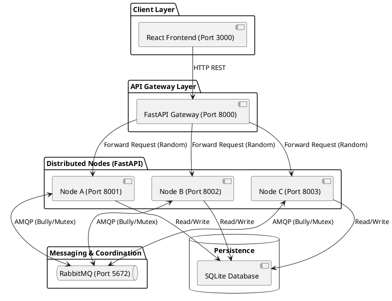
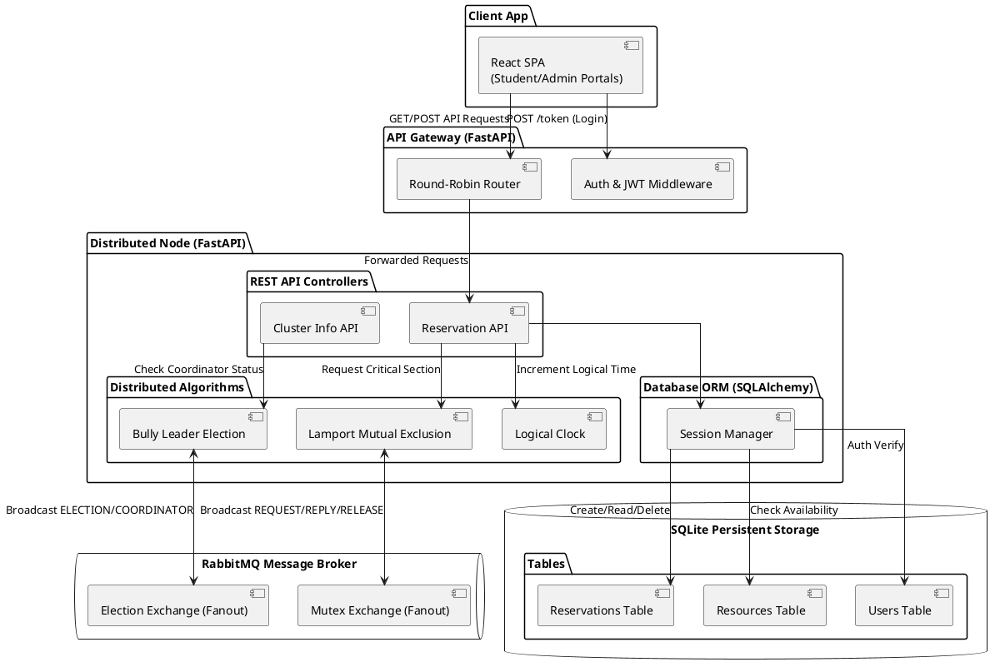
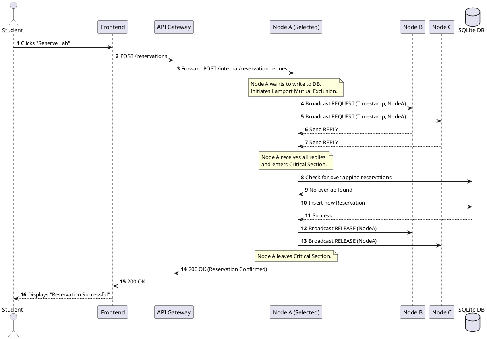
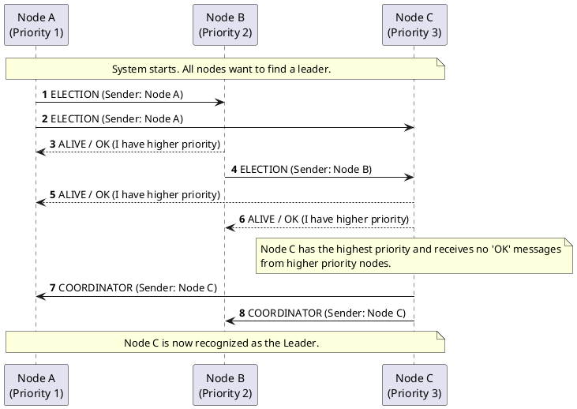

# Distributed Lab & Equipment Reservation System Diagrams

You can use the code blocks below to generate diagrams in StarUML (using the PlantUML extension), Draw.io, or standard Markdown viewers that support Mermaid.

## 1. High-Level System Architecture

---

## 2. Detailed Internal Component Architecture

This diagram breaks down the specific internal software components operating inside a single distributed Node, the Gateway, and the exact database tables and message queues involved.

---

## 3. Sequence Diagram: Reservation Flow (Mutual Exclusion)

This diagram visualizes what happens when a student requests a lab reservation. It showcases the Lamport Distributed Mutual Exclusion algorithm preventing double-bookings.

---

## 4. Sequence Diagram: Leader Election (Bully Algorithm)

This diagram details how nodes discover who is in charge (the coordinator) when the system starts or when a node fails.

